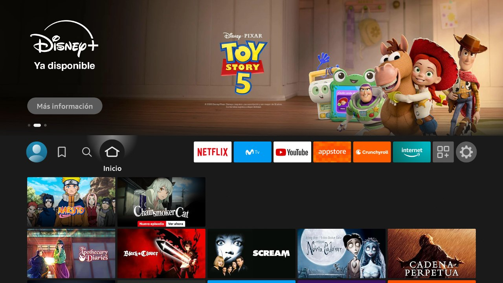
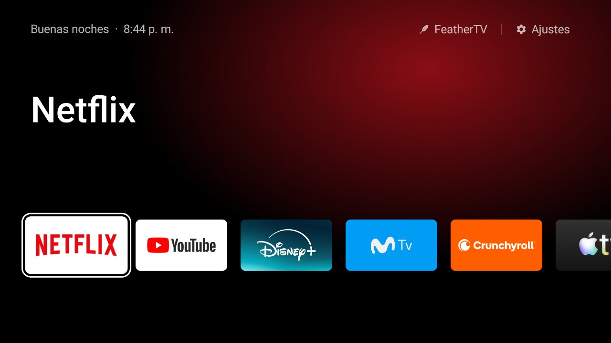
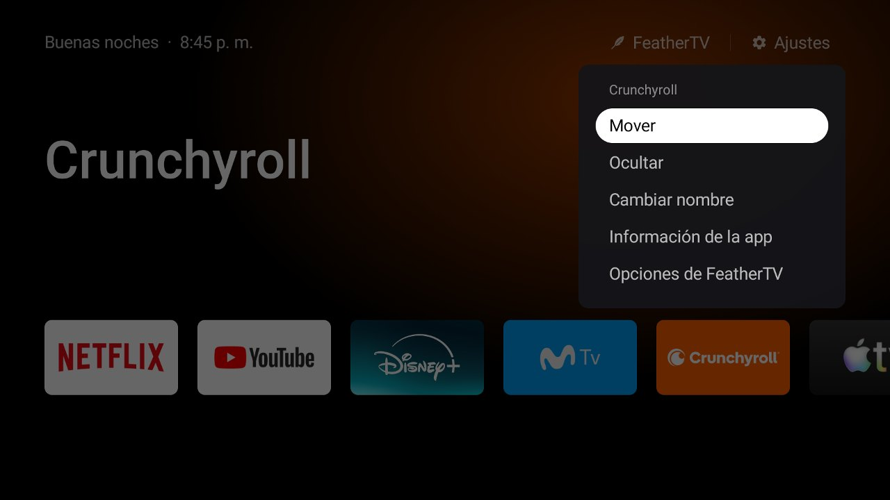

# FeatherTV vs. the standard Fire OS home screen

Measured on 2026-10-18 on a Fire TV Stick Lite (AFTSS) running Fire OS 7.7.1.7, medians of five
runs with [tools/bench.sh](../tools/bench.sh). Amazon's launcher was measured on the same device,
which already had part of Fire OS's advertising and telemetry disabled; on a Fire TV fresh out of the
box it is likely to be heavier.

| Fire OS (Amazon's launcher) | FeatherTV |
|---|---|
|  |  |
| A sponsored banner fills half the screen; your apps are a thin row between recommendations. | Your apps, the focused one's name in large type and a glow in its color. Nothing else. |

## By the numbers

| | Fire OS | FeatherTV |
|---|---|---|
| App size | 28 MB | **49 KB** (about 600 times smaller) |
| Idle memory | 121 MB (74 MB excluding graphics) | **44 MB** (24 MB excluding graphics) |
| Back to the home screen from an app (`am start`) | 376 ms | **96 ms** |
| Slow frames while moving through the apps | 39 % (p90 32 ms, p99 93 ms) | **6 %** (p90 14 ms) · 0 % with the black background |
| Home button, from the press to on screen | **673 ms** | 974 ms |
| Permissions | System (part of Fire OS) | **None**, not even internet |

The Home button is the only place where Fire OS wins: FeatherTV has to wait for Amazon's screen to
appear before replacing it (see the [README](../README.md#how-it-takes-over-the-home-button)), which
adds about 0.3 s. Amazon's launcher also stays loaded in the background: Fire OS doesn't allow
removing it, so FeatherTV's memory adds to it instead of replacing it. More detail in
[PERFORMANCE.md](PERFORMANCE.md).

## What changes

| | Fire OS | FeatherTV |
|---|---|---|
| Advertising | Full-screen sponsored banner and recommendation rows | None |
| What you see first | Content and promotions | Your apps |
| Ordering apps | Only the fixed row at the top | Any order, with ◀ ▶ |
| Hiding apps | No | Yes, and they can be brought back from Options |
| Renaming apps | No | Yes |
| Look | Fixed | Focus color, tile size, 12/24-hour clock, stage or black background |
| Language | The system's | The system's or its own (en, es, pt, fr, it, de) |
| Data collected by the home screen | Part of Fire OS's services (usage metrics, content recognition, advertising ID) | None |

## What you give up with FeatherTV

- The "Continue watching" and recommendation rows on the home screen.
- Amazon's on-screen search (Alexa voice search keeps working and isn't touched).
- The profile picker and the notification center on the home screen.
- About 0.3 s more when you press Home.

*An app's menu in FeatherTV (☰ or a long press on OK).*
